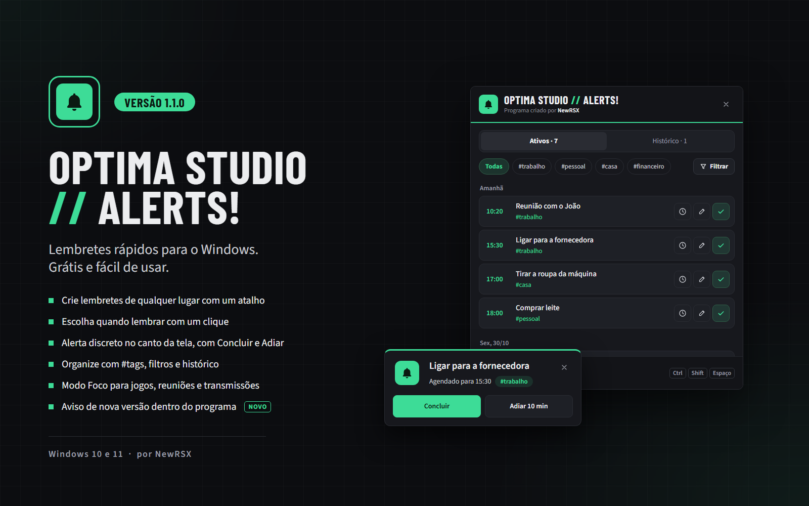

# Optima Studio // Alerts!

**PT-BR** · Lembretes rápidos e gratuitos para o Windows 10 e 11. Programa criado por **NewRSX**.
**EN** · Free quick reminders for Windows 10 and 11. Created by **NewRSX**.

## ⬇️ Download

### [⬇️ Baixar o instalador (versão 1.1.0)](https://github.com/rodrigoseixas82/optimastudio-alerts/releases/download/v1.1.0/OptimaStudio_Alerts_1.1.0.0.exe)

Baixe e dê dois cliques no arquivo para instalar. Já tem o programa? Instale por cima: seus lembretes e configurações são mantidos.

**EN** · [Download the installer (version 1.1.0)](https://github.com/rodrigoseixas82/optimastudio-alerts/releases/download/v1.1.0/OptimaStudio_Alerts_1.1.0.0.exe). Run it to install; to update, install over the old version and your reminders and settings are kept.

Versões anteriores / Previous versions: [todas as versões](https://github.com/rodrigoseixas82/optimastudio-alerts/releases)

> **"O Windows protegeu o computador"**: clique em *Mais informações* > *Executar assim mesmo*. O instalador não tem assinatura digital paga; não é vírus.
>
> **EN** · **"Windows protected your PC"**: click *More info* > *Run anyway*.

## O que faz / What it does

- Atalho (Ctrl + Shift + Espaço) para criar um lembrete de qualquer lugar · Shortcut (Ctrl + Shift + Space) to create a reminder from anywhere
- Escolha quando lembrar com um clique: 15 min, 1 hora, hoje à noite, amanhã de manhã, data e hora · Pick when with one click: 15 min, 1 hour, tonight, tomorrow morning, date and time
- Alerta discreto no canto da tela, com Concluir e Adiar · Discreet corner alert with Done and Snooze
- Organize com #tags, filtros e histórico · Organize with #tags, filters and history
- Modo Foco para jogos, reuniões e transmissões · Focus Mode for games, meetings and streams
- Lembretes que venceram com o PC desligado aparecem assim que ele volta · Reminders due while the PC was off show up when it's back
- Aviso de nova versão e atualização com um clique dentro do programa · In-app new version notice and one-click update

O programa avisa sozinho quando há uma versão nova aqui no GitHub. · The program tells you when a new version is published here.

## Apoie o projeto / Support

O Optima Studio // Alerts! é gratuito. · Optima Studio // Alerts! is free. ☕ [buymeacoffee.com/newrsx](https://buymeacoffee.com/newrsx) · Pix dentro do programa (Apoiar o projeto).
